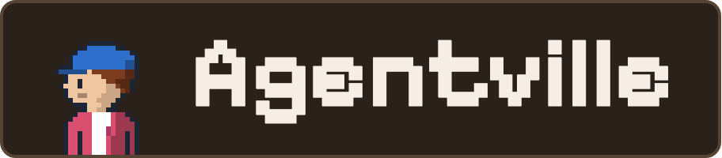
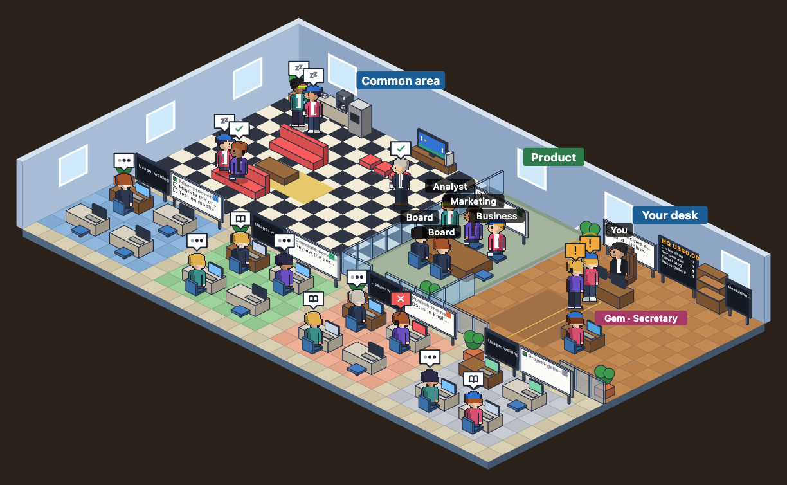
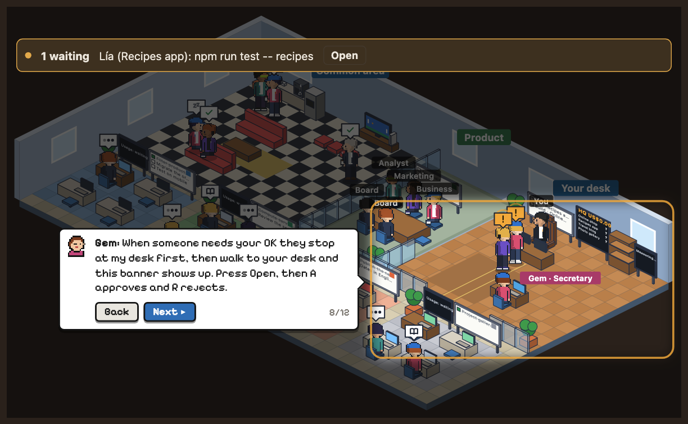

<p align="center">
  
  
</p>

# Agentville

Agentville is a pixel-art office for your Claude Code agents, as a Claude Code desktop mod. Each session is an office
with its team: the Lead (the session's main agent) and its subagents at their desks. Idle agents rest in the public
lounge, and agents that need your OK walk to your desk and wait in line. From the same panel you approve, answer and
message every session. The plugin id is `agentville@jandresgarcia`.

The panel speaks English or Spanish: pick the language in the tour's first step, or with `/agentville lang es|en`.



## Requirements

- Claude Code 2.1.299 or newer, the one that ships with the desktop app. The `claude` on your PATH may be older; the
  shell commands below need 2.1.299 or newer too.
- The Claude desktop app, for the map and the tour.
- macOS, the only platform Agentville is tested on.
- No `allowManagedHooksOnly` in your organization's managed settings.

Details: [Requirements](docs/install-and-update.md#requirements).

## Install

```bash
claude plugin marketplace add JAndresGarcia/agentville
claude plugin install agentville@jandresgarcia
```

Or in a session:

```
/plugin marketplace add JAndresGarcia/agentville
/plugin install agentville@jandresgarcia
```

Other ways (the desktop app, a local clone) and the `team_flow` option are in
[Install and update](docs/install-and-update.md).

The shell install asks nothing: no team flow is on until you pick one in the tour.

## First run

1. Start a new desktop session.
2. Type `/agentville`. The panel opens.
3. Gem, the Secretary, gives you a short tour of the real map. Its first step picks the language: the panel starts in
   English, and you can switch with ES | EN in its header or `/agentville lang es|en` any time.
4. The step "How do your teams work?" offers "Agentville team flow" (recommended),
   "One of my skills" or "No team flow".
5. The step "Where it opens" sets "Always open", which opens the panel in every
   session.



The Tour button in the panel's header runs the tour again. More in
[Using the panel](docs/using-the-panel.md).

## What you can do

1. **See every session at work.** Each session is an office with its team, its plan board and a usage
   screen (spend, context, tool calls). Click an agent to see its plan, steps and conversation.
   [Using the panel](docs/using-the-panel.md).
2. **Approve or reject from one desk.** Permission requests wait in line at your desk and on an amber "N waiting"
   strip. Approve and Reject (keys A and R) answer them without switching sessions. [Messages and permission
   requests](docs/remote-control-and-mailbox.md#permission-requests).
3. **Message and steer any session.** Send a message, paste an image, or stop a running turn; a `/command` runs only
   in the panel's own session, and for another one the panel types it into that session's empty prompt box for you to
   send, or copies it. Orders are signed, act once and stay on this machine. [Messages and permission
   requests](docs/remote-control-and-mailbox.md).
4. **Answer questions and suggested sessions.** When a turn ends with a question, press one of the replies Claude
   offered. Suggested sessions are notes on your desk: start or dismiss them.
   [Questions and suggested sessions](docs/using-the-panel.md#questions-and-suggested-sessions).
5. **Run changes through a team flow.** Optional. Every change is triaged small, medium or large by risk and goes
   through a spec, builders and reviewers sized to it. New or high-impact work is first checked against your goals
   file. A skill you type with its own build, review and PR workflow goes first, and a root CLAUDE.md line
   `Agentville: flow off` keeps a repository out of the flow.
   [Team flow](docs/team-flow.md) and [Impact and goals](docs/impact-and-goals.md).

Handy commands, typed after `/agentville`: `lite` (open without the map), `refresh` (hide offices with no work),
`sync` (bring old sessions up to date), `lang es|en`. Each also has a Spanish name, such as `ligero`. All of them:
[Commands](docs/using-the-panel.md#commands).

## Make it yours

- **Palette.** Pick the panel's colour at its foot or in the tour: Warm lobby (the default), Night or Hotel.
- **Language.** English or Spanish, in the tour or with `/agentville lang es|en`; add your own, see
  [Translate it](#translate-it).
- **Team flow on or off.** In the tour, choose "Agentville team flow", "One of my skills" or "No team flow"; the Tour
  button runs it again, and the `team_flow` install option works too. A line `Agentville: flow off` in a repository's
  root CLAUDE.md keeps that repository out. [Team flow](docs/team-flow.md).
- **Your own skills first.** A skill or command you type in a session that builds, reviews and opens a PR runs end to
  end; Agentville only shows the map. [Your own skill first](docs/team-flow.md#your-own-skill-first).
- **Ship fast.** One line in a repository's root CLAUDE.md, `Agentville: ship fast. Deploy: <command>`, merges and
  deploys once the tier's reviews (and, for a large change, the approver) accept, with no full suite and no CI wait.
  It counts only after you confirm it for that repository, and never covers secrets, tokens, auth or permissions.
  [Ship fast](docs/team-flow.md#ship-fast-opt-in).
- **Goals file.** Write your goals in `.agentville/metas.md` ("metas" means goals), so Product decides requests the
  way you would and asks you only about the grave ones. Its keys can be English or Spanish. See the example in
  [Goals file](docs/impact-and-goals.md#goals-file).
- **Your own team.** The agents and the flow are plain Markdown: edit or fork `agentville/agents/*.md` and
  `agentville/skills/team-flow/SKILL.md` to change how your team works.

## Translate it

All panel text lives in one table, `STRINGS` in `agentville/hooks/i18n.ts`. Each entry is a key and a pair
`[es, en]`: the Spanish text first, the English second.

To change wording:

1. Find the text in `agentville/hooks/i18n.ts` and edit the Spanish or English side of its pair.
2. Keep every `{placeholder}` (such as `{name}` or `{n}`) on both sides, and use no em dash.
3. Run `claude plugin test agentville`: a test checks that both sides are filled and have the same placeholders.
4. Type `/reload-plugins` in a session to see it.

To add a language (a code change today; open a pull request if you want it shipped):

1. In `agentville/hooks/i18n.ts`, add its code to `Lang` and `langOf`, add a third text to every pair in `STRINGS`,
   and make `t` pick it by index.
2. In `agentville/hooks/register.tsx`, add the code to the `lang es|en` command and to the ES | EN switch in the
   panel's header (the `['es', 'en']` lists), and in `agentville/hooks/tour.ts` to the tour's language step.
3. The tour's layout in `agentville/hooks/tourlayout.ts` was measured for Spanish and English: give the new
   language the English layout to start with, and check that its longer texts still fit.
4. Run `claude plugin test agentville` and fix what it reports.

## Privacy

Everything stays on this machine: the mod makes no network calls. It reads session status files and transcripts, and
writes only under `~/.claude/agentville` and its plugin store. Obvious tokens are masked before they are written.
What it reads, writes and runs: [Privacy and files](docs/privacy-and-files.md). Security summary, known limits and how
to report an issue: [SECURITY.md](SECURITY.md).

## Update, uninstall, blank panel

Update (then type /reload-plugins in each running session; [Update](docs/install-and-update.md#update)):

```bash
claude plugin marketplace update jandresgarcia && claude plugin update agentville@jandresgarcia
```

Uninstall ([Uninstall](docs/install-and-update.md#uninstall)):

```bash
claude plugin uninstall agentville@jandresgarcia
claude plugin marketplace remove jandresgarcia
```

Blank panel: `/agentville lite` opens it without the map; `/reload-plugins` redraws a frozen one.
[Troubleshooting](docs/troubleshooting.md).

## Docs

- [Install and update](docs/install-and-update.md): requirements, install options, update, uninstall, develop.
- [Using the panel](docs/using-the-panel.md): tour, map, list and detail, questions, commands.
- [Team flow](docs/team-flow.md): tiers, reviews, merge rule, tests, ship fast.
- [Impact and goals](docs/impact-and-goals.md): team names, the Secretary and Product, the goals file.
- [Messages and permission requests](docs/remote-control-and-mailbox.md): messages, permissions, signed orders.
- [Troubleshooting](docs/troubleshooting.md): blank panel, the panel going light, known limits, calibration.
- [Privacy and files](docs/privacy-and-files.md): what it reads, writes and runs.
- [Security](SECURITY.md): what the mod can do, known limits, how to report an issue.
- [Releasing](docs/releasing.md): version numbers, how a release is made, how to update.

## Develop

```bash
claude plugin validate --strict agentville && claude plugin test agentville
```

More in [Develop](docs/install-and-update.md#develop).

## Contributing

Issues and pull requests are welcome. Report a bug or ask for a feature with the
[issue forms](https://github.com/JAndresGarcia/agentville/issues/new/choose), and read
[CONTRIBUTING.md](CONTRIBUTING.md) before a pull request: how to run the tests, the style, the two-language text and
the security rules. Report a security issue privately, as [SECURITY.md](SECURITY.md#reporting-an-issue) says, never in
a public issue. Everyone taking part follows the [Code of Conduct](CODE_OF_CONDUCT.md).

## Versioning

Agentville follows [Semantic Versioning](https://semver.org/). Each release is a `vX.Y.Z` tag with a GitHub release,
and [CHANGELOG.md](CHANGELOG.md) lists what changed in each version. To update, see
[Update, uninstall, blank panel](#update-uninstall-blank-panel); how a release is made:
[Releasing](docs/releasing.md).

## License

See [LICENSE](LICENSE). Bundled fonts: [agentville/FONTS-OFL.txt](agentville/FONTS-OFL.txt).
